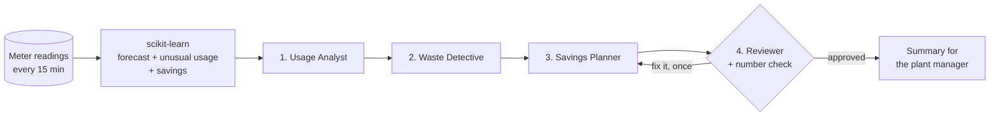

# ⚡ AI Factory Energy Optimizer

Finds where a steel plant wastes electricity, then uses 4 AI agents to explain it and plan fixes, with the money and CO₂ saved.

Built with Python, scikit-learn, Groq-hosted LLMs and Streamlit.

---

## The problem

A factory gets one electricity bill a month. It can't see where or when electricity was wasted: machines left on over the weekend, sudden unexplained spikes, or heavy work done when electricity is most expensive. Managers don't have time to dig through meter data.

## What the app does

1. Predicts normal usage with a scikit-learn model, so anything far above "normal" stands out.
2. Flags unusual usage with a second scikit-learn model.
3. Calculates three savings opportunities in code, in dollars and CO₂ per year.
4. Runs 4 AI agents that explain the findings and write an action plan. A Reviewer agent and a code check make sure the plan never claims more than the data supports.

| # | Agent | Job |
|---|---|---|
| 1 | **Usage Analyst** | Explains when and how the plant uses electricity |
| 2 | **Waste Detective** | Explains the biggest unusual spikes and their likely causes |
| 3 | **Savings Planner** | Writes the action plan: actions, owners, timelines, savings |
| 4 | **Reviewer** | Checks the plan against the data; sends it back once if it's wrong |



### Key design decisions
- Code calculates, AI explains. LLMs are unreliable at arithmetic, so every number comes from scikit-learn and pandas. The agents only explain the numbers and plan actions.
- A guardrail on the AI. A code check (`check_plan`) makes sure the plan leaves no savings opportunity out and that its numbers add up to what the data supports, never more. The Reviewer rejects plans that fail, and the Planner gets one chance to fix them, with the exact problems listed. If it still fails, a plan built directly from the data is used.
- Honest testing. The forecast is trained on Jan–Oct 2018 and tested on Nov–Dec, which it never saw, and compared with simple "copy yesterday" and "copy last week" guesses.
- No double counting. Each 15-minute reading counts toward at most one savings opportunity.
- Always works. Without an API key, or if Groq fails, each agent falls back to a template, and the page says why in plain words.

## Results (real plant data, Nov–Dec 2018)

**Forecast of normal usage**

| Method | Typical error (kWh per 15 min) | R² |
|---|---|---|
| **Random Forest** | **10.50** | **0.63** |
| Copy same time yesterday | 14.36 | 0.27 |
| Copy same time last week | 12.72 | 0.39 |

The model's error is 27% lower than copying yesterday's value.

**Savings found (per year)**

| Opportunity | $ / year | t CO₂ / year |
|---|---|---|
| Investigate unusual spikes | $3,478 | 14.4 |
| Run heavy jobs in cheaper hours | $2,247 | 0 (saves money, not energy) |
| Switch off machines when the plant is closed | $1,900 | 8.9 |
| **Total** | **$7,625** | **23.3** |

Example: on **Sunday 4 Nov 2018**, 13:30–16:15, with the plant closed, it used **994 kWh** when about **50 kWh** was expected.

Electricity prices ($0.18 peak, $0.09 off-peak per kWh) and the savings assumptions are illustrative and adjustable in the sidebar. CO₂ uses the dataset's own figures (about 0.42 kg per kWh).

## Quick start

```bash
git clone https://github.com/amrutakhot16/AI_Factory_Energy_Optimizer.git
cd AI_Factory_Energy_Optimizer
python3 -m venv .venv && source .venv/bin/activate    # Windows: .venv\Scripts\activate
pip install -r requirements.txt
python train.py                  # trains the two models (about 15 seconds)
cp .env.example .env             # then put your free key from console.groq.com in .env
streamlit run app.py
```

The API key and model are set only in `.env` and are never shown in the app. If the AI agents fail, run `python check_groq.py` to see why.

### Deploy
Deployed free on Streamlit Community Cloud. To deploy your own copy, add `GROQ_API_KEY`
(and optionally `GROQ_MODEL`) under the app's **Settings → Secrets**.

## Project structure
```
├── app.py            The Streamlit app (3 tabs)
├── train.py          Trains and tests the two models
├── check_groq.py     Checks your Groq key and model
├── src/
│   ├── data.py       Loads the data, fixes timestamps, builds features
│   ├── ml.py         The models and the savings calculations
│   └── agents.py     The 4 agents, the number check and the orchestrator
├── data/             Steel_industry_data.csv
└── docs/             Interview guide
```

## Limitations and next steps
- Prices and "how much can be switched off" are assumptions; a real plant would supply its own.
- The agents run in a fixed order with one review loop. A next step would be letting the Waste Detective query the data itself.
- Other ideas: live meter data, alerts when a spike starts, and measuring real savings after fixes.

## Dataset
*Steel Industry Energy Consumption*, UCI Machine Learning Repository: https://archive.ics.uci.edu/dataset/851 (real data from DAEWOO Steel, South Korea, 2018).
